<div align="center">

# 🌾 E-Farm Management System 🇧🇩
### *Government-Backed Digital Agriculture, Supply Chain Logistics & Farmer Empowerment Platform*


**Course:** Software Engineering (Section: U | Group: 05)  
**Semester:** Spring 2024–2025 | **Institution:** American International University-Bangladesh (AIUB)  
**Domain:** 🌾 E-Governance & Agricultural Supply Chain / 🌍 Socio-Economic Sustainability

</div>

---

## 📖 Table of Contents
- [📌 Project Overview](#-project-overview)
- [🎯 Problem Statement & Societal Impact](#-problem-statement--societal-impact)
- [🛠️ Software Engineering Methodologies & Tools](#️-software-engineering-methodologies--tools)
- [🔄 SDLC Process Model: Hybrid Incremental + Scrum](#-sdlc-process-model-hybrid-incremental--scrum)
- [📋 Requirements Engineering (SRS)](#-requirements-engineering-srs)
- [📐 System Architecture & UML Modeling](#-system-architecture--uml-modeling)
- [🎨 UI/UX Prototype Design (Figma)](#-uiux-prototype-design-figma)
- [🧪 Software Quality Assurance & Test Modeling](#-software-quality-assurance--test-modeling)
- [📊 Project Management: WBS, COCOMO, Gantt & EVA](#-project-management-wbs-cocomo-gantt--eva)
- [⚠️ Risk Management & Mitigation Plan](#️-risk-management--mitigation-plan)
- [📂 Repository File Structure](#-repository-file-structure)
- [👥 Project Group Members](#-project-group-members)

---

## 📌 Project Overview
**E-Farm Management System (`E-Farm BD`)** is a comprehensive software engineering architecture and UI/UX prototype designed to modernize Bangladesh's agricultural ecosystem under a centralized, government-led digital initiative.

Small and medium-scale farmers in Bangladesh frequently face exploitation by middlemen, post-harvest crop wastage, bureaucratic delays in accessing agricultural loans or subsidies, and a lack of real-time market linkage. This project engineers an end-to-end software blueprint—complete with **Hybrid Agile Scrum + Incremental SDLC planning**, **Object-Oriented UML modeling**, **14 high-fidelity mobile UI/UX screens**, **10 formal functional test specifications**, **COCOMO & Earned Value Analysis (EVA)** effort estimation, and a **proactive Risk Register**—to bridge the gap between rural farmers, government administrators, financial institutions, and transport logistics providers.

---

## 🎯 Problem Statement & Societal Impact

### Root Causes Addressed
* **Eliminating Middleman Exploitation:** Enables farmers to submit crop sale requests directly to government procurement channels at fair market prices.
* **Centralized Agricultural Data:** Replaces fragmented manual records with real-time regional crop production tracking to prevent artificial scarcity in urban zones like Dhaka, Chattogram, and Sylhet.
* **Streamlined Financial Aid & Resource Distribution:** Digitizes applications for agricultural loans, subsidies, seeds, fertilizers, and machinery rentals (`Water Pump`, `Tractor`), verified via National ID (NID) and field investigators.
* **Admin-Assisted & Offline-Ready Accessibility:** Designed with Bengali localization, icon-driven navigation, and offline synchronization to overcome the rural digital literacy and connectivity gap.

### Target Stakeholders
* **👨‍🌾 Small & Medium Farmers:** Direct crop sales, subsidized equipment rentals, government land/pond lease applications, and a gamified **Priority Ranking Tier (`Bronze`, `Silver`, `Gold`, `Platinum`)**.
* **🏛️ Government Administrators:** Centralized verification of farmer profiles, stock approvals, investigator dispatch, and national food supply analytics.
* **🚚 Transport Service Providers (Drivers):** Verified driver registration and automated pickup/drop-off route assignments based on trust score and location.
* **🏦 Financial Institutions & Field Investigators:** On-site land/property verification and direct bank fund disbursement.

---

## 🛠️ Software Engineering Methodologies & Tools

| Category | Methodology / Tool | Application in Project |
| :--- | :--- | :--- |
| **Process Model (SDLC)** | **Hybrid Incremental + Scrum** | Modular 5-sprint delivery combining structured incremental releases with Agile sprint reviews |
| **System & OOP Modeling** | **UML 2.5 (Use Case, Class, Sequence)** | Actor-system interaction mapping, abstract inheritance hierarchy (`Request`), and lifeline message flows |
| **UI/UX Prototyping** | **Figma** | 14 high-fidelity mobile application screens across Farmer, Admin, and Driver workflows |
| **Effort & Cost Estimation** | **Organic COCOMO & EVA** | Person-month effort calculation (`7,000 SLOC`), schedule duration, CPI (`0.560`), and SPI (`0.600`) tracking |
| **Project Scheduling** | **WBS & Gantt Chart** | 5-Sprint Work Breakdown Structure and multi-week resource allocation timeline |
| **Quality Assurance (SQA)** | **Black-Box Test Case Modeling** | 10 end-to-end functional test cases covering authentication, OTP, loans, leases, and logistics |
| **Risk Analysis** | **Probability-Impact Matrix** | Quantitative assessment and mitigation strategies across 11 operational, security, and technical risks |

---

## 🔄 SDLC Process Model: Hybrid Incremental + Scrum

After evaluating Waterfall, Prototyping, V-Model, RAD, and XP against the dynamic requirements of a multi-stakeholder public-sector platform, a **Hybrid Incremental + Scrum** methodology was selected.

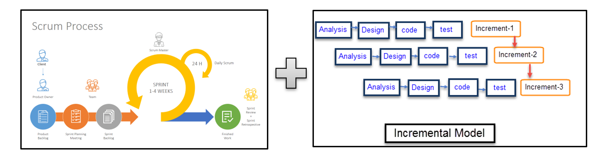

### 🗓️ 12-Week Sprint Implementation Roadmap
* **Weeks 1–2 (Requirement Analysis & Planning):** Define system structure, functional/non-functional requirements, UML use cases, and module prioritization.
* **Weeks 3–4 (Sprint 1 — User Access Implementation):** Farmer registration, NID verification, login security, OTP password recovery, and Admin approval interface.
* **Weeks 5–6 (Sprint 2 — Core Functional Modules):** Stock sale request submission, seasonal production updates, and real-time dashboards.
* **Weeks 7–8 (Sprint 3 — Application Features):** Loan/subsidy applications, field investigator workflow, and raw material/machinery rental module.
* **Weeks 9–10 (Sprint 4 — Extended Roles & Services):** Delivery driver registration, route assignment, government land/pond lease applications, and priority tier scoring.
* **Weeks 11–12 (Sprint 5 — System Finalization & Closure):** UI polishing, security audit, offline sync validation, and final project defense.

---

## 📋 Requirements Engineering (SRS)

<details>
<summary><b>🔍 Click to Expand: Complete Functional & Non-Functional Requirements Specification</b></summary>
<br>

### 1. Functional Requirements (FR)
| Module | Priority | Key Functional Specifications |
| :--- | :---: | :--- |
| **Farmer Registration & Account Control** | `High` | Admins register/update/delete farmers using Full Name, NID, Phone, Address, and Farming Type with automated NID/phone verification. |
| **Farmer Login & Security** | `High` | Phone + password authentication; 5 consecutive failed attempts lock the account for 1 hour. |
| **Password Recovery (OTP)** | `Medium` | 6-digit SMS OTP verification (5-minute expiry) via registered NID/phone and strong password policy enforcement. |
| **Stock Sale Request Management** | `High` | Farmers submit crop type, quantity, unit price, and harvest pickup date; Admins approve/reject and schedule driver pickup. |
| **Loan & Subsidy Application** | `High` | Farmers submit bank info, land details, crop type, and requested amount; Admins assign field investigators before bank disbursement. |
| **Raw Material & Machinery Request** | `High` | Farmers request seeds/fertilizers or rent machinery (e.g., tractors, water pumps) at government-subsidized rates. |
| **Production & Sale Update** | `Medium` | Farmers log harvested crop metrics; Admin verification updates the farmer's activity score. |
| **Farmer Priority System** | `Medium` | Ranks farmers into `Bronze`, `Silver`, `Gold`, and `Platinum` tiers based on transparency and reporting frequency. |
| **Government Land/Pond Lease** | `Medium` | Digital application for government land/ponds with physical investigator verification and digital lease certification. |
| **Driver Registration & Logistics** | `High` | Drivers register with NID, license, and vehicle info; Admins assign pickup/drop-off tasks with distance/load incentives. |

### 2. Non-Functional Requirements (NFR) & Constraints
* **Usability:** Bengali language support, icon-assisted forms, and tooltips for semi-literate rural users.
* **Performance:** Page load and form submission response time $\le 3\text{ seconds}$; supports up to $10,000$ concurrent users.
* **Security:** End-to-end encryption for NID and bank records, Role-Based Access Control (RBAC), and 30-minute idle session timeouts.
* **Reliability & Availability:** $99.9\%$ uptime during peak harvest seasons, automated 6-hour database backups, and offline mobile caching with background sync.
* **External Constraints:** Integration with National ID verification standards, Google Maps API for driver routing, and Bangladesh Government digital security compliance.

</details>

---

## 📐 System Architecture & UML Modeling

The system architecture is modeled using **UML 2.5 standards** to establish clear actor boundaries, object-oriented class hierarchies, and time-ordered interaction lifelines.

### 1️⃣ Use Case Diagram
Maps interactions across 5 primary actors (**Farmer**, **Admin**, **Driver**, **Field Investigator**, and **Financial Institution**) and 20 core use cases with `<<include>>` relationships.

<div align="center">
  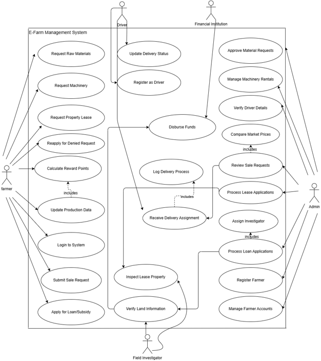
</div>

---

### 2️⃣ Object-Oriented Class Diagram
Demonstrates encapsulation, association multiplicities, and polymorphism via the abstract `Request` base class inherited by `SaleRequest`, `LeaseRequest`, and `LoanRequest` alongside `Admin`, `Farmer`, `Driver`, `Delivery`, `Product`, `FieldInvestigator`, and `FinancialInstitution`.

<div align="center">
  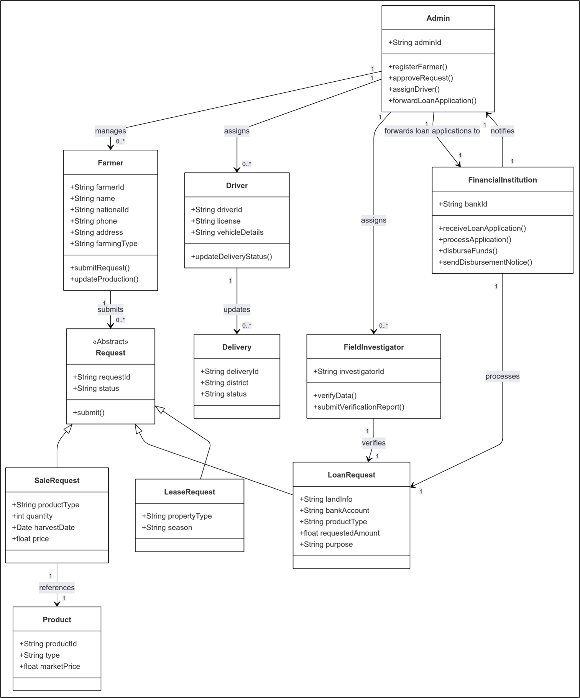
</div>

---

### 3️⃣ System Sequence Diagram
Illustrates chronological message passing and conditional `alt` fragments (`[Approved]` vs. `[Rejected]`, `[Available]` vs. `[Unavailable]`) across Farmer Registration, Stock Sale & Delivery Assignment, Loan Inspection & Disbursement, Resource Requests, and Driver Onboarding.

<div align="center">
  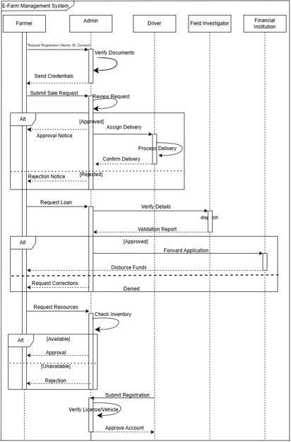
</div>

---

## 🎨 UI/UX Prototype Design (Figma)

The mobile user interface (`E-Farm BD`) was designed in **Figma** with high-contrast green agricultural theming, minimal text entry, and intuitive icon cards tailored for rural accessibility.

### 🔐 1. Authentication & OTP Password Recovery Flow
| Login Screen | Create Account (NID & Birth Date) | Reset Password (Request OTP) |
| :---: | :---: | :---: |
| 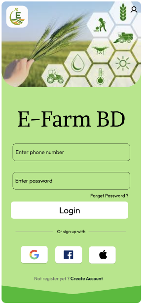 | 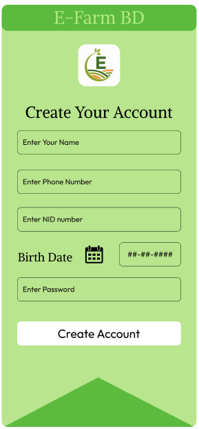 | 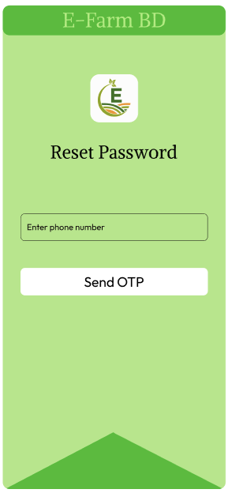 |

| OTP Code Verification | Set New Password | Farmer Main Dashboard |
| :---: | :---: | :---: |
| 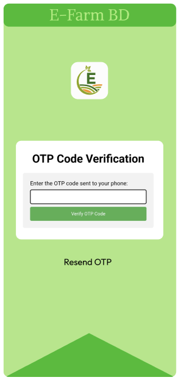 | 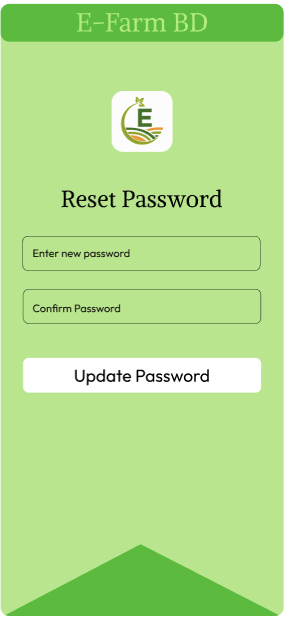 | 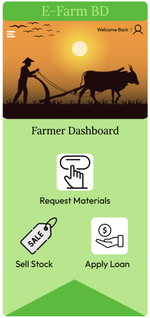 |

---

### 🌾 2. Farmer Service Request Workflows
| Stock Sale Request Form | Loan Application Form | Material & Machinery Request Form |
| :---: | :---: | :---: |
| 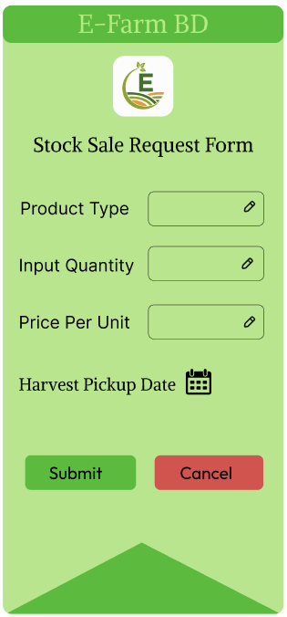 | 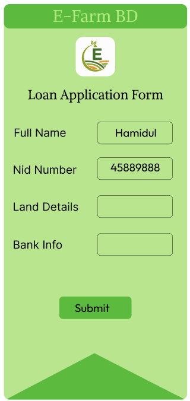 | 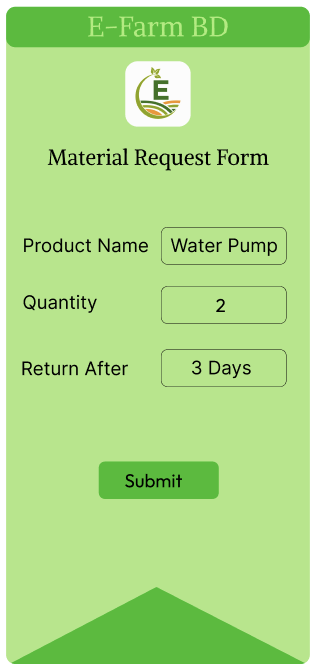 |

---

### 🏛️ 3. Government Admin & Logistics Driver Dashboards
| Admin Control Dashboard | Farmer Request Approval Card | Pending Loan Verification Card |
| :---: | :---: | :---: |
| 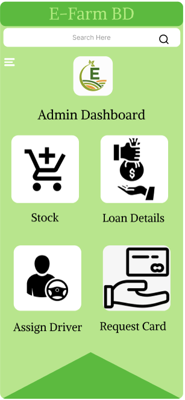 | 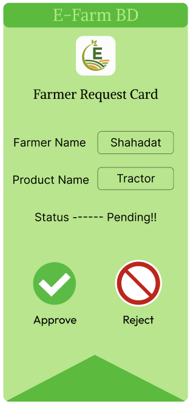 | 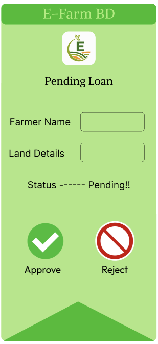 |

| Admin Driver Route Assignment | Driver Delivery Dashboard |
| :---: | :---: |
| 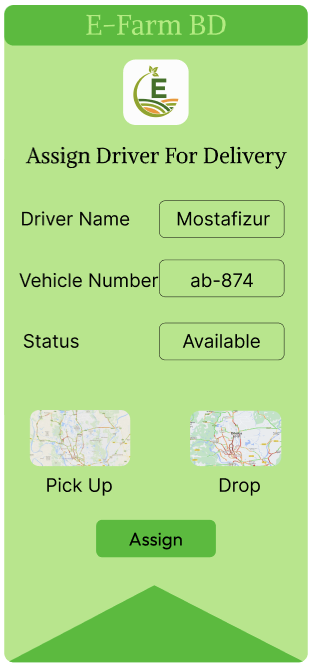 | 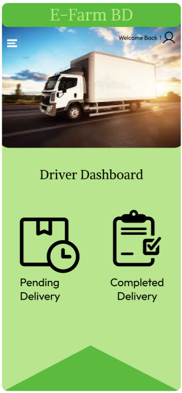 |

---

## 🧪 Software Quality Assurance & Test Modeling

A suite of **10 formal Black-Box Functional Test Cases** was engineered to validate system reliability, input verification, security lockouts, and role workflows.

| Test ID | Module Name | Test Case Title | Priority | Designed By |
| :---: | :--- | :--- | :---: | :--- |
| **TC-01** | Farmer Account Control | Farmer Registration and Account Control by Admin | `High` | Mostafizur Rahman |
| **TC-02** | Farmer Login | Farmer Login, Credential Verification & 5-Attempt Lockout | `High` | Mostafizur Rahman |
| **TC-03** | Password Recovery | Farmer Password Reset via NID/Phone & 6-Digit OTP | `Medium` | Mostafizur Rahman |
| **TC-04** | Stock Sale Management | Farmer Stock Sale Request & Admin Approval/Pickup Scheduling | `High` | Shahadat Hossain |
| **TC-05** | Loan & Subsidy Application | Farmer Loan Application, Field Inspection & Bank Transfer | `High` | Shahadat Hossain |
| **TC-06** | Raw Material & Machinery | Subsidized Fertilizer Request & Monthly Tractor Rental Logging | `High` | Shahadat Hossain |
| **TC-07** | Production & Sale Update | Harvest Record Entry, Admin Validation & Activity Scoring | `Medium` | Hamidul Islam |
| **TC-08** | Farmer Priority System | Tier Ranking (`Bronze`–`Platinum`) Based on Activity & Transparency | `Medium` | Hamidul Islam |
| **TC-09** | Government Lease Application | Pond/Land Lease Application, Inspection & Certificate Issuance | `Medium` | Hamidul Islam |
| **TC-10** | Driver & Delivery Logistics | Driver Registration, License Verification & Task Wage Calculation | `High` | Mostafizur Rahman |

<details>
<summary><b>🔍 Click to Expand: Detailed Test Data & Expected Results</b></summary>
<br>

* **TC-01 (Account Control):** Tests registration with `Name: "Rahim Uddin"`, `NID: "1998456721345"`, `Address: "Kurigram"`, `Farming Type: "Rice"`. Verifies credential dispatch and Admin CRUD actions.
* **TC-02 (Login Security):** Validates login with `Pass: "Farm@1234"` and confirms that 5 consecutive invalid attempts trigger a 1-hour temporary account lock.
* **TC-03 (OTP Reset):** Tests 6-digit OTP (`123456`) verification and enforces strong password formatting (`NewPass@123`) with SMS confirmation.
* **TC-04 (Stock Sale):** Tests submission of `Product: "Potato"`, `Qty: 500 kg`, `Price: 20 BDT/kg`, `Harvest Date: 2025-07-10` and verifies pre-approval cancellation/editing.
* **TC-05 (Loan Processing):** Validates loan request (`Bank: "Agrani Bank"`, `Land: "2 acres"`, `Crop: "Jute"`, `Amount: "50,000 BDT"`) through investigator inspection to disbursement.
* **TC-06 (Material/Machinery):** Tests `Item: "Fertilizer" (200 kg)` and `Machine: "Tractor" (1 month)` with subsidized rate calculation.
* **TC-07 & TC-08 (Production & Priority Tier):** Logs `Product: "Wheat" (300 kg @ 24 BDT/kg, Bogura Bazar)` and verifies that an `Activity Score: 85` upgrades dashboard status to `Gold`.
* **TC-09 (Property Lease):** Tests `Type: "Pond"`, `Location: "Rangpur"`, `Purpose: "Fish farming"` through physical inspection and lease certification.
* **TC-10 (Driver Logistics):** Validates driver onboarding (`License: "DL-450932"`, `Vehicle: "Pickup Van"`, `Destination: "Khulna"`) and distance-based incentive payout.

</details>

---

## 📊 Project Management: WBS, COCOMO, Gantt & EVA

### 1️⃣ Work Breakdown Structure (WBS)
Decomposes the project lifecycle into 6 primary phases (**Requirement Analysis & Planning** and **Sprints 1–5**) with 12 deliverable work packages.

<div align="center">
  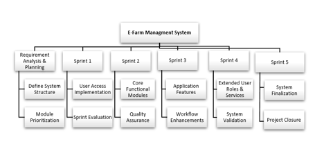
</div>

---

### 2️⃣ Project Schedule & Resource Gantt Chart
Tracks task dependencies, sprint milestones, and resource assignments across **Hamidul Islam (`HI`)**, **Shahadat Hossain (`S`)**, and **Mostafizur Rahman (`RS`)** from March to June 2025.

<div align="center">
  
  <br>
  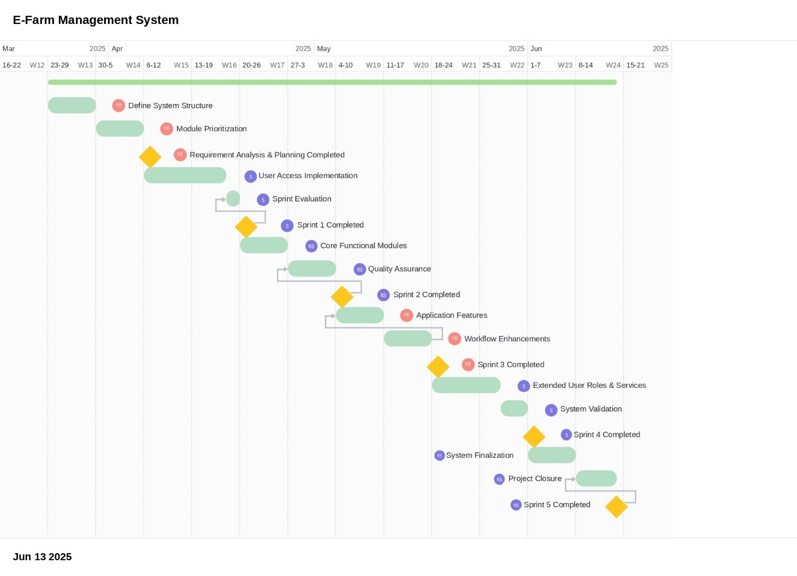
</div>

---

### 3️⃣ Constructive Cost Model (COCOMO) Estimation
Calculated using the **Organic COCOMO Model** based on an estimated size of **$7,000\text{ SLOC}$** ($7\text{ KLOC}$), Coefficient $a = 2.4$, Exponent $P = 1.05$, and $T = 0.38$:

$$\text{Effort (PM)} = 2.4 \times \left(\frac{7000}{1000}\right)^{1.05} = 18.517\text{ Person-Months}$$

$$\text{Duration (DM)} = 2.50 \times (18.517)^{0.38} = 7.579\text{ Months}$$

$$\text{Average Staffing (ST)} = \frac{\text{PM}}{\text{DM}} = \frac{18.517}{7.579} = 2.443 \approx 3\text{ Team Members}$$

---

### 4️⃣ Earned Value Analysis (EVA)
Evaluated across 10 core work packages with a **Budget at Completion ($\text{BAC}$)** of $300\text{ person-days}$ and $60\%$ assumed milestone completion:

| Metric | Formula | Calculated Value | Interpretation |
| :--- | :--- | :---: | :--- |
| **Planned Value ($\text{BCWS}$)** | $\sum \text{Planned Task Effort}$ | $85\text{ person-days}$ | Total effort scheduled across the 10 tasks |
| **Earned Value ($\text{BCWP}$)** | $0.60 \times \text{BCWS}$ | $51\text{ person-days}$ | $60\%$ of planned work completed |
| **Actual Cost ($\text{ACWP}$)** | $\sum \text{Actual Task Effort}$ | $91\text{ person-days}$ | Actual effort expended by the team |
| **Schedule Variance ($\text{SV}$)** | $\text{BCWP} - \text{BCWS}$ | $-34\text{ person-days}$ | Behind initial schedule baseline |
| **Schedule Performance Index ($\text{SPI}$)** | $\text{BCWP} / \text{BCWS}$ | $0.600$ | Operating at $60\%$ of planned schedule rate |
| **Cost Variance ($\text{CV}$)** | $\text{BCWP} - \text{ACWP}$ | $-40\text{ person-days}$ | Over planned effort budget |
| **Cost Performance Index ($\text{CPI}$)** | $\text{BCWP} / \text{ACWP}$ | $0.560$ | Earning $0.56$ units of value per effort unit |
| **Scheduled Completion %** | $(\text{BCWS} / \text{BAC}) \times 100$ | $28.33\%$ | Percentage of total project scheduled |
| **Work Completed %** | $(\text{BCWP} / \text{BAC}) \times 100$ | $17.00\%$ | Percentage of total project completed |

---

## ⚠️ Risk Management & Mitigation Plan

<details>
<summary><b>🔍 Click to Expand: Complete Risk Register (11 Identified Risks & Mitigation Strategies)</b></summary>
<br>

| Risk Description | Category | Probability | Impact (1–3) | Mitigation Strategy |
| :--- | :--- | :---: | :---: | :--- |
| **Low digital literacy among rural farmers** | Customer | `70%` | `3 (High)` | Provide Bengali-language UI, icon-based navigation, offline mode, and local admin assistance. |
| **Module integration delays due to small team size** | Project Schedule | `60%` | `3 (High)` | Utilize Scrum sprints, parallel task allocation, and weekly progress tracking. |
| **Unreliable internet connectivity in rural areas** | Technology | `60%` | `2 (Med)` | Enable offline mobile data entry with lightweight caching and background synchronization. |
| **Server overload during peak harvest seasons** | Technology | `50%` | `3 (High)` | Deploy scalable cloud infrastructure with load balancing and regular stress testing. |
| **Delays in transport availability updates from drivers** | Operational | `50%` | `2 (Med)` | Configure automated driver reminders, real-time status requirements, and manual admin reassignment. |
| **Resistance to platform adoption by traditional farmers** | Customer Behavior | `50%` | `2 (Med)` | Launch local awareness campaigns and incentivize early adopters via the Bronze–Platinum priority system. |
| **Inaccurate or fraudulent crop/loan data entries** | Data Integrity | `40%` | `3 (High)` | Enforce automated NID validation, audit logs, and mandatory physical field inspection for loans/leases. |
| **Security breaches involving financial or NID data** | Security | `40%` | `3 (High)` | Apply end-to-end encryption, RBAC, 30-minute session timeouts, and periodic security audits. |
| **Bugs discovered in critical modules** | Quality | `40%` | `3 (High)` | Conduct continuous sprint-based unit, integration, and user acceptance testing (UAT). |
| **Low stakeholder engagement from local offices** | Stakeholder | `30%` | `3 (High)` | Schedule regular sprint review demos and interactive feedback workshops. |
| **Conflicts over resource allocation priorities** | Management | `30%` | `2 (Med)` | Maintain transparent audit logs, automated priority scoring, and admin override controls. |

</details>

---

## 📂 Repository File Structure

```text
E-Farm-Management-System-SE/
├── assets/                                                  # 21 Architectural, UML, Figma & PM Diagrams
│   ├── Picture0.png                                         # Hybrid Scrum + Incremental Process Model
│   ├── Picture1.png                                         # UML Use Case Diagram
│   ├── Picture2.png                                         # UML Class Diagram
│   ├── Picture3.png                                         # UML Sequence Diagram
│   ├── Picture4.png                                         # Figma UI: Login Screen
│   ├── Picture5.png                                         # Figma UI: Create Account Screen
│   ├── Picture6.png                                         # Figma UI: Reset Password (Send OTP)
│   ├── Picture7.png                                         # Figma UI: OTP Code Verification
│   ├── Picture8.png                                         # Figma UI: Update New Password
│   ├── Picture9.png                                         # Figma UI: Farmer Dashboard
│   ├── Picture10.png                                        # Figma UI: Stock Sale Request Form
│   ├── Picture11.png                                        # Figma UI: Loan Application Form
│   ├── Picture12.png                                        # Figma UI: Material Request Form
│   ├── Picture13.png                                        # Figma UI: Admin Dashboard
│   ├── Picture14.png                                        # Figma UI: Farmer Request Approval Card
│   ├── Picture15.png                                        # Figma UI: Pending Loan Approval Card
│   ├── Picture16.png                                        # Figma UI: Assign Driver for Delivery
│   ├── Picture17.png                                        # Figma UI: Driver Dashboard
│   ├── Picture18.png                                        # Work Breakdown Structure (WBS)
│   ├── Picture19.png                                        # Gantt Chart Team Member Legend
│   └── Picture20.png                                        # Project Schedule Gantt Chart
├── E-Farm Management System - A Software Engineering Project.pdf  # Complete 51-Page Project Report
└── README.md                                                # Project Documentation
```

---

## 👥 Project Group Members

| Name | Student ID | Contribution | Assigned Software Engineering Modules |
| :--- | :---: | :---: | :--- |
| **Shahadat Hossain** | `23-51341-1` | `35%` | **Project Proposal, Literature Review, SDLC Process Model, Project Roles, Requirements Engineering (FR/NFR), COCOMO & EVA Calculations, Risk Management & Test Cases (TC 4–6)** |
| **Hamidul Islam** | `23-50447-1` | `35%` | **Project Proposal, Figma UI/UX Prototype Design (14 Screens), UML Class Diagram, UML Use Case Diagram, Work Breakdown Structure (WBS), Gantt Chart & Test Cases (TC 7–9)** |
| **Mostafizur Rahman** | `23-50829-1` | `30%` | **UML Use Case Diagram, UML Sequence Diagram, Gantt Chart Scheduling & Test Cases (TC 1–3, TC 10)** |

---

<div align="center">
  <i>Developed for the Software Engineering Course (Spring 2024–2025, Section U, Group 05) at American International University-Bangladesh (AIUB).</i>
</div>